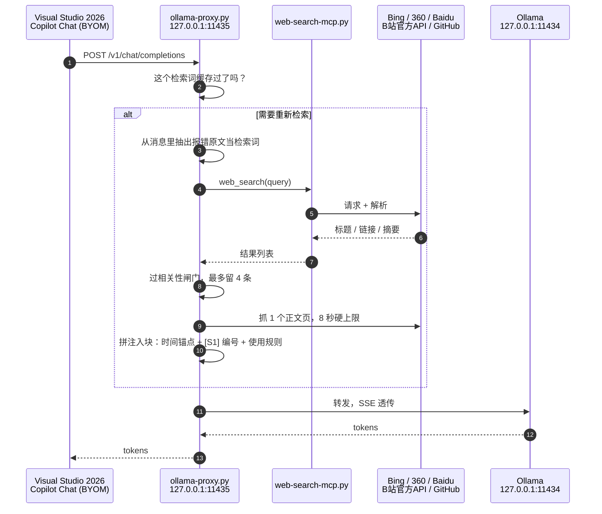

<!-- badges -->


# 在 Windows 上用 Intel Arc 跑 Qwen3-Coder 30B，接进 Visual Studio 2026 联网写代码

一张 Arc Pro B60 专门推理，一张 A750 负责亮机。Ollama 官方版加一个纯标准库写的 Python 代理，
让 VS2026 的 Copilot Chat 用上本地 30B 模型，而且真的会联网。

我这台机器（i5-13500 / Arc Pro B60 24G + A750 8G / 48G / Win11）跑出来的数字：

| 项目 | 实测 |
|---|---|
| 生成速度（Qwen3-Coder-30B-A3B，IQ4_NL） | 66–70 tok/s |
| 长文生成（一次 7758 tokens 跑完） | 40.7 tok/s |
| 首次加载模型 | 46.2 s（设了 `KEEP_ALIVE=-1`，只付一次） |
| 联网查询端到端 | 5.9 s（同问题不联网是 3.0 s） |
| 注入的检索上下文 | 421 tokens（改造前同一道题是 1721 tokens，还把资料引错了） |
| 依赖 | 0，纯 Python 标准库，不用 pip install |

跑通了，天天在用，但它不是产品。哪些地方现在还不靠谱，第 9 节都写了。

## 目录

- [1. 为什么折腾这个](#1-为什么折腾这个)
- [2. 它能干什么](#2-它能干什么)
- [3. 架构](#3-架构)
- [4. 一步步装起来](#4-一步步装起来)
- [5. 配置项](#5-配置项)
- [6. 它怎么决定要不要联网](#6-它怎么决定要不要联网)
- [7. 实测数据](#7-实测数据)
- [8. 踩过的坑](#8-踩过的坑)
- [9. 现在还不行的地方](#9-现在还不行的地方)
- [10. 相关项目](#10-相关项目)

## 1. 为什么折腾这个

写代码的时候，我大概有一半时间花在两件事上：查某个 API 到底怎么用，和看某个报错到底什么意思。

云端服务当然省事，但有两件事我一直不太舒服。一是断网或者对方抽风的时候，补全和问答会一起消失。
二是有些代码我不想往外传，哪怕只是想问个小问题。

桌上那张 24G 的 Arc Pro B60 一直闲着，那就别浪费了。目标定得挺具体：

- 模型跑在本机，推理不出公网；
- 在编辑器里就能用，不用来回切浏览器和终端；
- 能联网。本地模型的知识有截止日期，这是我用了一周之后最难受的地方；
- 少装东西。每多一个组件，就多一个半夜挂掉的理由。

最后一条把后面的技术选型全定了。

### 为什么没上 IPEX-LLM

Intel 自家的 IPEX-LLM 在 Arc 上确实更快，我认真考虑过。最后没用，理由说起来有点土：
它有自己的运行时和 Ollama 分支，模型导入、模型管理、对外的接口都跟着它那一套走。
我想要的是标准 Ollama 加标准 OpenAI 兼容接口，中间少一层，出问题的时候我能确定是谁的问题。

这是取舍，不是结论。你要是只追求吞吐，IPEX-LLM 值得单独试一轮。

### 为什么不用 Open WebUI / SearXNG / Docker

社区的标准答案是 Open WebUI 当前端，SearXNG 当元搜索，再加一堆容器。
为了一个搜索功能去养三个服务，我觉得不划算。

而且我要的不是"一个漂亮的聊天网页"，是在编辑器里问问题的时候答案能带上最新信息。
那最省事的位置就是中间塞一个薄代理：判断该不该搜，搜完把结果拼进 prompt，再转发给 Ollama。

`ollama-proxy.py` 就是这么来的，一个文件，出问题直接看日志。

## 2. 它能干什么

- **零依赖**。纯 Python 标准库，没有 `requirements.txt`，不用 pip install，不用申请 API key。
- **对客户端零改动**。它就是个 OpenAI 兼容端点。VS2026 的 BYOM、Continue、Cline，
  甚至一条 `curl` 都能直接接，不需要装任何插件。
- **按需联网，不是每次都搜**。纯概念题、纯代码题、以及"继续""好的"这种话都直接跳过。
  白搜一次要 11 秒加 1500 tokens 上下文，跳过就是白省。
- **检索词用报错原文**。不把整句话丢给搜索引擎。同一道题，整句检索 0/5 相关，抽原文 5/5 正解。
- **注入前过一道相关性闸门**。按字面重合度打分，内容农场直接剔除，最多留 4 条。
- **搜不到就承认搜不到**。一条都不相关时，明确告诉模型"这次没搜到有用的，用你自己的知识回答，
  不要编链接"，而不是硬塞垃圾进去。
- **带时间锚点和来源编号**。注入块里有检索时间戳，每条来源编成 `[S1]`、`[S2]`，并要求模型引用。
- **多引擎回退**。Bing 主搜，360 和 Baidu 备用。每个引擎有独立解析器，另有通用兜底解析器，
  页面改版时是降级，不是直接崩。
- **B站走官方 API（WBI 签名）**。直接爬会被 `-352`、`-412` 风控。走签名接口拿到的是真实粉丝数、
  视频列表和播放量。
- **检索块按问题缓存**。VS 的 agent 模式每一轮工具往返都会重发同一条用户消息。
  有了缓存，三轮对话只搜一次。
- **抓正文有硬超时**。`urlopen` 的 timeout 管不住 DNS 解析（我实测有个 URL 挂了 145 秒），
  所以抓取放进线程池，限时 8 秒。
- **流式透传**，不缓冲。

## 3. 架构



看不懂 Mermaid 的话，文字版：

```
VS2026 (BYOM) ──► 127.0.0.1:11435  ollama-proxy.py
                        │
                        ├─ ① 缓存命中？命中就直接复用，不重复搜
                        ├─ ② 该不该联网（规则判定）
                        ├─ ③ 抽检索词 → web-search-mcp.py → Bing / 360 / Baidu
                        │                              └─ B站官方 API（WBI 签名）
                        │                              └─ GitHub 仓库直读 README
                        ├─ ④ 过相关性闸门，最多 4 条
                        ├─ ⑤ 抓 1 个正文页，8 秒上限
                        └─ ⑥ 拼注入块 → 转发到 127.0.0.1:11434
                                                  qwen3-coder:30b（Arc Pro B60 24G）
                                                  qwen3:4b-local
                              显示输出：Arc A750 8G
```

### 文件说明

| 路径 | 作用 |
|---|---|
| `proxy/ollama-proxy.py` | 监听 11435。拦聊天请求，判断是否联网，注入检索结果，转发到 11434。相关性闸门、检索块缓存、抓取硬超时都在这里 |
| `proxy/web-search-mcp.py` | 搜索后端。Bing/360/Baidu 多引擎解析、正文抓取、B站 WBI 签名接口、GitHub README 直读。它本身也能当 MCP stdio 服务器单独跑 |
| `scripts/start-proxy.ps1` | 后台启动并自检，推荐用这个 |
| `scripts/start-proxy-hidden.vbs` | 同样的事，给不想用 PowerShell 的人 |
| `models/Modelfile.import-from-gguf` | 第一步，把下载的 GGUF 导入成 Ollama 模型 |
| `models/Modelfile.qwen3-coder-30b-tuned` | 第二步，叠上官方推荐的采样参数 |
| `models/Modelfile.qwen3-4b` | 4B 小模型 |
| `docs/BENCHMARKS.md` | 所有实测数字、测法，以及哪些数字不能当规格看 |
| `docs/AUDIT.md` | 两轮体检记录：发现了什么、怎么修的、我自己判断错过什么 |

## 4. 一步步装起来

### 0. 前置

- Windows 11
- Intel Arc 显卡（我用的是 Arc Pro B60 24G 推理，A750 8G 负责显示）
- [Ollama 官方版](https://ollama.com/download)，我验证的是 0.35.1
- Python 3.11+，要在 PATH 里
- Visual Studio 2026 Insiders，BYOM 需要比较新的版本
- 内存建议 32G 以上，我这台是 48G

```powershell
ollama --version
python --version
```

把仓库拉到本地，后面所有命令都在仓库根目录执行：

```powershell
git clone https://github.com/Yien1024/qwen3-coder-arc-vs2026.git
cd qwen3-coder-arc-vs2026
```

### 1. 装 Ollama，配四个环境变量

| 变量 | 值 | 作用 |
|---|---|---|
| `OLLAMA_MODELS` | `D:\AI-Models\ollama` | 模型库放数据盘，别占系统盘 |
| `OLLAMA_CONTEXT_LENGTH` | `65536` | 默认上下文。代码场景够用，但它有硬上限行为，见第 8 节 |
| `OLLAMA_KV_CACHE_TYPE` | `q8_0` | KV cache 量化，省显存 |
| `OLLAMA_KEEP_ALIVE` | `-1` | 模型常驻显存，不用反复吃 46 秒的加载 |

```powershell
[Environment]::SetEnvironmentVariable("OLLAMA_MODELS",         "D:\AI-Models\ollama", "User")
[Environment]::SetEnvironmentVariable("OLLAMA_CONTEXT_LENGTH", "65536",               "User")
[Environment]::SetEnvironmentVariable("OLLAMA_KV_CACHE_TYPE",  "q8_0",                "User")
[Environment]::SetEnvironmentVariable("OLLAMA_KEEP_ALIVE",     "-1",                  "User")
```

确认写进去了，然后完全退出 Ollama 再启动。托盘图标右键 Quit，环境变量对已经跑着的进程不生效。

```powershell
[Environment]::GetEnvironmentVariable("OLLAMA_CONTEXT_LENGTH", "User")   # 应该输出 65536
Get-Process ollama* | Stop-Process
ollama serve
```

### 2. 导入 GGUF，再叠采样参数

Ollama 官方库里没有 IQ4_NL 这一档量化，所以模型得手动导入。
我选 IQ4_NL 是因为它比 Q4_K_M 在这台机器上省大约 2GB 显存，而 24G 卡上这 2GB
正好决定 64K 上下文能不能稳住。

先把 `models/Modelfile.import-from-gguf` 里的 `FROM` 改成你的 GGUF 路径，然后：

```powershell
ollama create qwen3-coder:30b -f models/Modelfile.import-from-gguf
ollama create qwen3:4b-local  -f models/Modelfile.qwen3-4b
```

再叠上采样参数。这一步不会复制 17GB 权重，只是给同一个模型加几行配置：

```powershell
ollama create qwen3-coder:30b -f models/Modelfile.qwen3-coder-30b-tuned
```

检查一下五个参数都在：

```powershell
ollama show qwen3-coder:30b --parameters
# temperature 0.7 / top_p 0.8 / top_k 20 / repeat_penalty 1.05 / num_predict 8192
ollama list      # qwen3-coder:30b 大约 17 GB
```

有个小坑：重新 create 一个 tag 会让 Ollama 换 runner，那一瞬间可能有一两个请求返回 HTTP 400。
重试一次就好。

### 3. 确认它真的跑在 Arc 上

```powershell
ollama run qwen3-coder:30b --verbose "用一句话解释 MoE 是什么"
```

`--verbose` 会打出生成速度和 prompt 处理速度。

然后另开一个终端，趁模型还在跑：

```powershell
ollama ps
```

`PROCESSOR` 那一列必须是 100% GPU。如果显示成 CPU/GPU 混合，说明有层掉到内存里了。

顺便说个要有心理准备的事：每个"第一发"请求大约要等 10 到 12 秒（我实测 12.17 秒，
之后同样请求是 0.68 秒和 0.81 秒）。

### 4. 启动代理

```powershell
pwsh -File scripts\start-proxy.ps1
```

先看代理活着没：

```powershell
curl.exe -s http://127.0.0.1:11435/v1/models
```

应该返回 Ollama 的模型列表 JSON。再打一发真实请求：

```powershell
curl.exe -s http://127.0.0.1:11435/v1/chat/completions `
  -H "Content-Type: application/json" `
  -d "{\"model\":\"qwen3:4b-local\",\"messages\":[{\"role\":\"user\",\"content\":\"React 19 有哪些新特性\"}],\"stream\":false,\"max_tokens\":80}"
```

然后翻代理日志（`ollama-proxy.log`，和 `ollama-proxy.py` 放一起），应该能看到这几行：

```
[proxy 2026-10-06 02:09:22] search query (extracted): React 19 有哪些新特性
[proxy 2026-10-06 02:09:22] search: engine=bing raw=8 kept=4 thr=0.30 realtime=False weak=False
[proxy 2026-10-06 02:09:22] fetching content result: https://zh-hans.react.dev/learn
```

看不到这几行，说明请求压根没经过代理，或者被判成不需要联网。

### 5. 接进 VS2026

Copilot Chat，点模型选择器，进 Manage Models（也就是 BYOM）。菜单文案各个版本会飘，
认准下面这几项就行：

| 配置项 | 值 |
|---|---|
| Provider | OpenAI 兼容（自定义 endpoint） |
| Base URL | `http://127.0.0.1:11435/v1` |
| API Key | 随便填个非空的，本地代理不校验，比如 `local` |
| Model | `qwen3-coder:30b` |
| Tool Calling | 看情况开，先读下面的提醒 |
| Max Input Tokens | `61440` |

Base URL 这里是最容易填错的地方。11434 是 Ollama 自己的端口，填了它聊天一切正常，
但请求永远不经过代理，也就永远不会联网，而且不报任何错。

Max Input Tokens 填 61440 而不是 65536，是因为模型的 `num_ctx` 正好是 65536，
而代理是在 VS 算完输入预算之后才追加检索块的（400 到 1600 tokens）。
填满 65536 就会被顶出去，Ollama 直接甩一个 HTTP 400 回来。留 4K 余量最省事。

关于 Tool Calling，有件事得先说清楚。打开之后 VS 会把自己的 agent 工具一起发过来，
包括 PowerShell 执行和文件读写，还带着一段两万五千字符的系统提示。
我在日志里真的看到过工具执行结果回灌给模型。本地模型没有做过对齐和安全训练，
要不要给它这个权限，你自己掂量。

配置落在哪个文件里，可以直接打开看：
`%LOCALAPPDATA%\Microsoft\VisualStudio\Copilot\BringYourOwnModel\ConfiguredBringYourOwnModel_v2.json`

### 6. 后台静默启动

```powershell
wscript.exe scripts\start-proxy-hidden.vbs
```

想开机自启，把它的快捷方式丢进 `Win+R` 然后输 `shell:startup` 的那个文件夹里。

## 5. 配置项

### 代理侧可调参数

都在 `proxy/ollama-proxy.py` 顶部：

| 常量 | 默认 | 含义 |
|---|---:|---|
| `RELEVANCE_MIN` | `0.30` | 通用相关性阈值，低于它的结果不注入 |
| `RELEVANCE_MIN_REALTIME` | `0.15` | 新闻、价格、"最新版本"这类时效问题的放宽阈值 |
| `MAX_INJECTED` | `4` | 最多注入几条来源 |
| `FETCH_DEADLINE_S` | `8` | 抓正文的硬超时，单位秒 |
| `BLOCK_TTL_S` | `300` | 检索块缓存多久，单位秒。VS 的 agent 模式靠它避免每轮重搜 |
| `LISTEN_PORT` | `11435` | 监听端口 |
| `UPSTREAM` | `127.0.0.1:11434` | 上游 Ollama 地址 |

### 两个控制符

写在消息任意位置即可：

| 控制符 | 作用 |
|---|---|
| `[no-search]` | 强制这一轮不联网 |
| `[search]` | 强制这一轮联网，比如概念题被跳过规则误伤了 |

### 想改它的脾气，改这些关键词表

同样在 `ollama-proxy.py` 顶部：`_REALTIME_KEYWORDS`（时效词）、
`_CODE_SEARCH_KEYWORDS`（需要新信息的代码题）、`_CODE_PURE_SIGNALS`（纯代码题，跳过）、
`_PURE_KNOWLEDGE_RE`（纯概念题，跳过）、`_CONTINUATION_RE`（"继续""好的"这类，跳过）、
`_LOW_QUALITY_HOSTS`（内容农场黑名单）、`_TRUSTED_HOSTS`（高置信来源加分）。

## 6. 它怎么决定要不要联网

每次请求按顺序走这些判断，每一步在日志里都能看到：

1. **"你能联网吗"这种问题，不搜。** 搜它只会得到词典释义。
2. **延续性的话，不搜。** `继续`、`好的`、`还有吗`、`谢谢`。以前这些会触发完整搜索，
   检索词就是"继续"两个字，纯属浪费。
3. **有时效关键词，搜。** `最新`、`今天`、`价格`、`版本`、`天气` 这类。
4. **需要新信息的代码题，搜。** 比如带 `报错`、`error`、`api`、`版本`、`新特性` 的。
   这条判定放在概念题判定前面，所以"解释一下 React 19 有什么新特性"仍然会搜。
5. **纯概念题，不搜。** `解释一下…`、`什么是…` 而且长度不超过 40 字。
   我强制搜过"解释一下什么是 MoE 架构"，Bing 返回 8 条，**0 条过得了相关性闸门**。
   这类题不光是搜得慢，是真的搜不到有用的东西。
6. **实体和事实问题，搜。** `是谁`、`是什么`、`介绍一下`。
7. **剩下的交给纯代码题判断。** 是"写个函数""重构一下"这种，就不搜。

决定要搜之后：

8. **抽检索词。** 有报错原文就用报错原文，抽不到才退回整句清洗。
   同一时刻同一引擎的对比：整句"Python报错 ModuleNotFoundError: No module named requests
   怎么解决"返回的是 Python 官网、下载页、菜鸟教程，0/5 相关；
   抽出来的"ModuleNotFoundError: No module named requests"是 5/5 全是正解页。
9. **过相关性闸门。** 剔除内容农场，按字面重合度打分，最多留 4 条。
   老版本这里是按域名给分，把 CSDN 和 Stack Overflow 打成了同样的分数，
   结果把一篇《Windows 下如何安装 Python》顶成了正文页，塞给模型，还写着"请直接引用这些结果回答"。
10. **一条都不相关就认输。** 注入"本次检索没有找到与问题相关的内容"，
    并要求模型说明没搜到、不要编造链接。
11. **抓一个正文页，8 秒硬上限。** GitHub 仓库走 API 直接读 README，不爬页面。
12. **拼注入块。** 内容有检索时间、检索词、`[S1]` 编号的来源，以及使用规则：
    可能过时也可能无关，不相关就忽略；引用要标来源；和你的知识冲突要指出来；
    先给依据再给结论；最后列出还不确定的点。

## 7. 实测数据

数字都是在这台机器上测的。具体测法和注意事项在 [docs/BENCHMARKS.md](docs/BENCHMARKS.md)，
里面也写了哪些数字受机器热状态影响、不能当规格用。

### 速度

| 项目 | 实测 |
|---|---|
| 生成速度（短请求，热态，连测三次） | 66.3 / 66.9 tok/s |
| 长文持续生成（238 tokens） | 65.0 tok/s |
| 长文持续生成（7758 tokens，一次"写完整 CLI 程序"） | 40.7 tok/s |
| 首次请求（冷） | 12.17 s |
| 之后同样请求（热） | 0.68 / 0.81 s |
| 工具调用（26 个工具，热态） | 0.34–0.55 s |

我最开始记下来的 69.7 tok/s 生成、303.7 tok/s prompt 处理、46.2 秒首次加载跟上面是一回事，
数量级对得上。

### 联网要花多少时间

| 项目 | 实测 |
|---|---|
| 搜索后端本身（Bing 抓取加解析） | 0.17–0.30 s |
| 端到端，联网 | 5.9 s |
| 端到端，同问题加 `[no-search]` | 3.0 s |
| 注入块大小（改造后） | 421 tokens |
| 注入块大小（改造前，同一道题） | 1721 tokens，而且资料引错了 |
| 三轮 agent 对话的搜索次数 | 1 次搜索加 2 次缓存命中（改造前是 3 次） |

搜索后端只花 0.2 秒，所以时间不是花在搜索上，是花在抓正文页和被注入撑大的 prompt 上。
注入让 prompt 从 16 涨到 1600 多 tokens，这才是延迟的大头。所以"少搜、搜准"比"多搜"重要得多。

### prompt 越大越慢

| prompt tokens | 一次请求耗时 |
|---|---|
| 约 9.3K | 18.4 s（同一个 prompt 复测是 2.3 到 6.1 s，前缀缓存生效了） |
| 38.1K | 248 s |
| 64.9K | 694 s，将近 12 分钟 |

这批数字受机器热状态影响很大。同一轮测试跑完之后我复测那个 9K prompt，
从 18.39 秒变成了 6.10 秒，然后又变成 2.30 秒。当数量级看就行，别当规格。
能确定的只有一条：VS 里对话越长越慢，该开新会话就开。

### 上下文超了会怎样

是报错，不是静默截断：

```
HTTP 400 {"error":{"code":400,
  "message":"request (38131 tokens) exceeds the available context size (32768 tokens), try increasing it",
  "type":"exceed_context_size_error"}}
```

不会悄悄丢数据，这点挺好。但长会话会直接失败，所以第 4 节里那个 Max Input Tokens 要留余量。

### 模型本身

| 项目 | 结果 |
|---|---|
| 工具调用（OpenAI 风格 tools） | `finish_reason=tool_calls`，参数正确 |
| 流式加 26 个工具 | `finish_reason=tool_calls`，`index` 正确递增 |
| 思考模式 | 没有。`ollama show` 只报 `tools, completion`，官方模型卡也确认是 non-thinking |
| 多步推理 | 数学应用题分步推理加回代验证，全对 |
| 长上下文捞针（17K tokens） | 精确命中 |
| 输出上限 | 一次请求用掉 7758 / 8192 tokens 后自然结束，余量只剩 5% |

## 8. 踩过的坑

**VS 里聊天正常，但从来不联网。**
Base URL 填成 11434 了。那是直连 Ollama，一切正常，只是永远不经过代理，而且不报任何错。

**VS2026 的 MCP 配置保存后显示 `UserDisabled`，工具列表里没有我自己的服务器。**
我遇到的就是这个，不同 Insiders 版本可能已经修了。可以去翻
`%LOCALAPPDATA%\Microsoft\VisualStudio\Copilot\McpServers\*.cache`，
如果里面只有 NuGet 自带的 MCP 工具，说明你的服务器从来没注册成功过。
这也正是这个项目存在的原因：不在 VS 这边做工具调用，把联网能力藏到 OpenAI 兼容端点后面，
VS 以为自己只是在跟一个普通模型说话。

**模型回答"我无法联网"。**
代理在注入块里写明了"你已接入互联网，请直接引用结果"，但 VS 那段两万五千字符的系统提示
有可能压过它。注入是追加到用户消息而不是 system 消息的，就是为了尽量靠近对话末尾。
如果还是被压过去，检查一下你的 system prompt 里有没有"你没有联网能力"这类强硬措辞。

**回答变成空白。**
换成 thinking 模型（比如 `qwen3:4b-local`）之后，思考内容走的是单独的 `reasoning` 字段。
我实测 `max_tokens=400` 时思考把预算全吃光了，`content` 是空的，给到 2500 才吐出答案。
所以别把输出预算设小。

**长会话突然报错。**
超出 `num_ctx` 了。是 `HTTP 400 exceed_context_size_error`，不是截断。
开个新会话，或者按第 4 节把 Max Input Tokens 降到 61440。

**B站搜索返回空，或者报 -352、-412。**
直接爬会被风控。必须走官方 API 加 WBI 签名（`w_rid` 和 `wts`）。
签名算法会随它前端改版变化，哪天 B站搜索全空了，八成就是签名过期，
去看它前端 JS 就知道了。代码在 `proxy/ollama-proxy.py` 的 `_bili_*` 系列函数里。

**搜出来一堆 CSDN 和内容农场。**
已经在 `_LOW_QUALITY_HOSTS` 里剔除了，想加就改那个列表。

**某道题该搜却没搜。**
大概率是纯概念题跳过规则误伤了，比如"解释一下什么是 WBI 签名"这种带专有名词的概念题。
在消息里加 `[search]` 强制联网就行。

**抓网页卡住不动。**
`urlopen` 的 timeout 不覆盖 DNS 解析，我实测有个 URL 挂了 145 秒才返回。
代码已经用线程池给抓取加了 8 秒硬超时，嫌短就改 `FETCH_DEADLINE_S`。

## 9. 现在还不行的地方

- 没有自动化测试。所有验证都是手工探针加真实请求。改代码之前先看 `docs/AUDIT.md` 里的测法。
- 只在一台机器、一个 Ollama 版本（0.35.1）、一个 Insiders 版本上验证过。
  Windows 加 Arc 这个组合本身就挺野，你的环境大概率和我不一样。
- 相关性闸门比的是字面重合度，不是语义。它对整句提问和拉丁技术词会有假阴性，
  现在靠"永不滤空加低置信度标注"兜底，但它仍然不懂同义词。
- 搜索质量完全取决于 Bing。没有排序学习，没有交叉验证，也没有可信度判断。
- B站 WBI 签名会过期。它改一次前端我就得跟着改一次。
- 判定规则是死的。"为什么不生效"这种没有具体名词的追问，它还是会白搜一次。
  想修就得判断消息里有没有可检索的实体，而这类规则很容易误伤"苹果股价多少"，不划算。
- 没有试过让 4B 小模型当"检索路由器"，也就是让模型决定该不该搜、把问题改写成检索词。
  设计上可行，代价是每次多一次模型调用。
- 性能数字受机器热状态影响很大，见第 7 节。
- 双卡混跑、多模型并发、模型自动切换，都没有。我也不打算为了"看起来完整"而假装有。

## 10. 相关项目

做之前和做完之后都看了一圈同类项目，这个方案不是凭空想的：

- [py-sandy/llm-web-relay](https://github.com/py-sandy/llm-web-relay)
  一个 FastAPI 网关，做按需检索、多语言时效检测、时间锚定、上下文注入、SSE 透传。
  和这个项目最像。我注入块里那套"时间锚点加引用编号加先依据后结论"的设计就是从它那儿学的。
  区别是它依赖 Tavily 和 SerpAPI 的 key，这边零依赖零 key。
- [azhao1981/llm_search_proxy](https://github.com/azhao1981/llm_search_proxy)
  中文的 LLM 搜索增强代理。
- [Open WebUI 的 Agentic Search](https://docs.openwebui.com/features/chat-conversations/web-search/agentic-search/)
  让模型自己决定调不调搜索工具的那一派。
- [Higress AI Search](https://higress.cn/en/docs/latest/user/plugins/ai/api-dev/ai-search/)
  网关层"按需激活"的工业级参考。
- Ollama 的两个 issue，排查的时候读过：
  [#16212](https://github.com/ollama/ollama/issues/16212)，qwen3-coder 流式 tool_calls 全部是
  `index=0`，我在 0.35.1 上没复现，应该是修了。
  [#14601](https://github.com/ollama/ollama/issues/14601)，`tools` 参数下工具定义被序列化成
  Go 结构体，这个不适用于我的模型，因为模板来自 GGUF，用 `tool | tojson` 正确序列化了。
- 模型和参数来源：
  [Qwen3-Coder-30B-A3B-Instruct 模型卡](https://huggingface.co/Qwen/Qwen3-Coder-30B-A3B-Instruct)。

## License

[MIT](LICENSE)

搜索后端会抓取第三方网页，用之前自己确认一下符合目标站点的使用条款。
